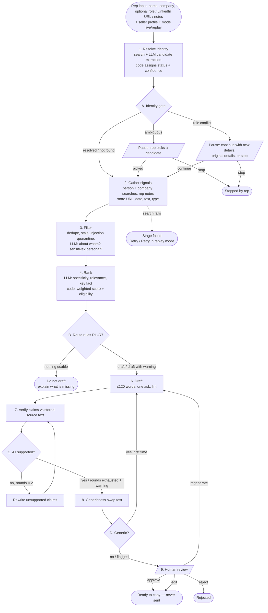

# Process Map — Prospect → Personalised Outreach Draft (PS-3)

Written before any code. It is the contract the build follows; where the build diverged, the change is
recorded in `DECISIONS.md`.

## 1. What goes in

| Input | Required | Notes |
|---|---|---|
| Prospect name | yes | Free text. |
| Company | yes | Free text, as the rep knows it (may be out of date — that is an edge case). |
| Role | no | Used to disambiguate and to detect role changes. |
| LinkedIn URL | no | Stored as a *claimed identifier* only. **Never fetched or scraped.** |
| Rep notes / pasted post | no | Treated as a first-class signal (source = "rep-provided") **and as untrusted text** (it may contain injected instructions). |
| Seller profile | yes (seeded) | Product, ideal customer, problems solved, proof points, tone. Seeded with the fictional AP-automation company **Ledgerline**. Editable. Snapshotted onto every run so history stays reproducible. |
| Mode | yes (default **live**) | `live` = real web search. `replay` = reuse search results stored from an earlier live run of the same prospect. Labelled on screen and stored on the run. LLM calls are live in both modes. |

## 2. Stages

Every stage persists: `status` (pending → running → succeeded / failed / skipped / waiting), `started_at`,
`finished_at`, `duration_ms`, `input`, `output`, a plain-English `explanation`, technical `details`, LLM tokens and
cost. Every status change is written to an event log that the UI streams over Server-Sent Events.

### Stage 1 — Resolve identity
- **Does:** 2–3 web searches (`"name" "company"`, `"name" role`, `"name" company news`). The LLM reads the
  results (as untrusted data) and extracts *candidate people*: name, company, role, whether the evidence says
  they are **current** or **former**, and the URLs that support each.
- **Code decides** (not the LLM) the identity status and confidence:
  - `resolved` — one candidate matches name + company with current-tense evidence. Confidence high if role also
    matches and ≥2 independent sources agree; medium otherwise.
  - `ambiguous` — ≥2 distinct candidates are plausible for the input (different roles/companies/locations
    with similar evidence strength), or sources conflict about who this is.
  - `role_conflict` — the best candidate matches the name, but recent evidence says they *left* the input
    company or now hold a different role / company.
  - `not_found` — no source mentions this person with this company. Confidence low; company research continues.
- **Decision point A (identity gate):**
  - ambiguous → **pause** (`ask_rep`). UI shows candidates with evidence; rep picks one or stops.
  - role_conflict → **pause** (`ask_rep`). UI shows input vs. evidence; rep chooses *continue with new details*,
    *continue with original details*, or *stop*. The original input is never overwritten — the choice is stored
    alongside it.
  - resolved / not_found → continue.

### Stage 2 — Gather signals
- **Does:** searches for person-level signals (interviews, podcasts, talks, quotes, posts) and company-level
  signals (funding, hiring, press, product launches, news; news searches limited to the last 12 months). Rep
  notes become a signal. For every result we store **source URL, title, publication date (or "unknown"),
  retrieved text, provider, query and signal type**.
- **Failure path:** search provider timeout/error → retried 2× with backoff → stage **fails** visibly. The UI
  offers *Retry* and, if saved sources exist for this prospect, *Retry in replay mode*.

### Stage 3 — Filter
- **Code:** dedupe (normalised URL, near-duplicate titles), drop stale items (> 18 months old), run a
  prompt-injection detector on every text (suspicious text is quarantined: kept for audit, never shown to the
  drafting model).
- **LLM (judgement, schema-validated):** for each remaining item — is it about *this* person, *this* company,
  or something else? What type is it? Is it **sensitive** (layoff, lawsuit, breach, executive departure,
  personal event)? Does it contain **personal details** (family, health, home location)?
- **Code drops:** unrelated items, personal-detail items. Each drop is stored with its reason and shown in the UI.

### Stage 4 — Rank
- **LLM (judgement, per signal, 0–3 rubric):** specificity to this person; relevance to the seller's problems;
  the single *key fact* the signal supports (quoted verbatim from the source text).
- **Code (formula, transparent):**
  `score = 0.30·specificity + 0.30·relevance + 0.25·recency + 0.15·credibility`
  - recency: 1.0 if ≤ 30 days, linear to 0.1 at 365 days, 0.3 if undated; rep notes 0.8.
  - credibility: tiered by source (wire/major press 1.0, company's own domain 0.9, trade/industry press 0.75,
    rep-provided 0.7, other 0.5).
  - A signal whose key fact can't be found verbatim in its own text gets relevance and specificity zeroed
    (the LLM can't invent a hook).
- **Hook eligibility:** sensitive signals are *never* eligible as a cheerful hook. The UI shows why the winner won
  (its top components and margin) and why each other signal lost (largest component gap, or ineligible reason).

### Stage 5 — Route (deterministic rules, in order)
| # | Condition | Route | Personalisation |
|---|---|---|---|
| R1 | Rep chose *stop* at an identity gate | **do_not_draft** (stopped by rep) | — |
| R2 | No eligible signal scores ≥ 0.30 | **do_not_draft** — explain what is missing | none |
| R3 | The top sensitive item about the person/company is "the strongest news" (within 0.10 of the best safe hook, **or** it outranks every safe company-level item) **and unavoidable** (≤ 30 days old, or ≤ 90 days and specific to the person/team) | **draft_with_warning** — best safe hook, sensitive tone, rep acknowledgement required | person/company |
| R4 | Same, but avoidable (older or less specific) and a safe alternative ≥ 0.30 exists | **draft** with the safe alternative; note the avoided signal | from alternative |
| R5 | Best eligible signal is company-level only (no person-level signal ≥ 0.40) | **draft_with_warning** — "lower personalisation" | company |
| R6 | Identity confidence low (not found, or rep continued on original details despite conflict) | **draft_with_warning** | as found |
| R7 | Otherwise | **draft** | person |

`ask_rep` is the route recorded at decision point A. A run therefore has a *route path*, e.g.
`ask_rep → draft_with_warning`, and a final route.

### Stage 6 — Draft
- **LLM** writes `{subject, body, hook_signal_id, problem, ask}` against a strict schema. Only the chosen hook,
  2 supporting signals, and the seller profile are given. Rules: ≤ 120 words, one low-friction ask, no flattery,
  no clichés, no invented familiarity, sensitive tone when R3.
- **Code lint:** word count, banned phrases, exclamation marks, number of asks. One automatic retry with the lint
  errors; if it still fails the issues become warnings.

### Stage 7 — Verify
- **LLM** splits the draft into atomic factual claims and, for each, cites a source (`signal_id` or
  `seller_profile.<field>`) and a verbatim supporting quote.
- **Code** checks each quote actually appears in the stored source text (fuzzy match ≥ 90). Claim = supported only
  if the quote is found **and** the LLM judges it entails the claim.
- Unsupported claims → LLM rewrites the draft removing/softening them → re-verify. Max **2** rewrite rounds.
- Still unsupported → continue to review with a red warning listing each unsupported claim.

### Stage 8 — Genericness check
- **Code:** a draft with zero verified prospect-specific claims is generic by definition.
- **LLM swap test:** names are masked and the draft is tested against two decoy prospects (different role, industry
  and company). If it still makes sense for a decoy, it is generic.
- Generic → regenerate once (stages 6–8). Still generic → flag in review.

### Stage 9 — Human review (run pauses: `awaiting_review`)
- Rep actions: **approve** (marks *ready to copy* — nothing is sent), **edit** (stores final text, edit distance),
  **reject** (with reason), **regenerate** (new draft from the same evidence, optional instruction).
- R3 drafts cannot be approved until the rep ticks the sensitive-signal acknowledgement.
- Stored: original draft, every version, final text, action, who/when.

## 3. Decision points summary
- **A — identity gate** (after stage 1): continue / pause for candidate choice / pause for role conflict.
- **B — route** (stage 5): draft / draft_with_warning / do_not_draft (+ ask_rep recorded at A).
- **C — verification loop** (stage 7): supported → continue; unsupported → rewrite (≤ 2) → warn.
- **D — genericness loop** (stage 8): specific → continue; generic → regenerate once → flag.
- **E — review** (stage 9): approve / edit / reject / regenerate.

## 4. Failure paths
| Failure | Behaviour |
|---|---|
| Search provider down / timeout | Retries (2, exp. backoff, 20 s timeout). Stage marked **failed** with the error. Run status `failed`. UI: Retry / Retry in replay mode. |
| LLM timeout / 5xx / 429 | SDK retries + our retry (2). Then stage **failed**. Never shown as success. |
| LLM returns invalid JSON / schema violation | Re-asked once with the validation error. Then stage **failed**. |
| LLM refusal | Stage **failed** with "model declined" message. |
| Prompt injection detected in a source | Source quarantined, listed in UI with reason; run continues. |
| Replay requested but no saved sources | Stage 1 fails immediately: "No saved sources for this prospect — run live first". |
| Server restart mid-run | On boot, interrupted runs are marked failed ("interrupted"), with Retry. |
| Rate limit / budget exceeded | Request rejected with 429 and a plain-English message before any cost is incurred. |

## 5. What comes out
- A run record: inputs, seller-profile snapshot, mode, every stage (I/O, timing, status, explanation), all signals
  with sources, ranking with score breakdown, route path, draft versions, claim-by-claim verification linked to
  sources, genericness result, warnings, tokens, estimated cost, duration, review action and final text.
- Run outcomes: `approved`, `approved_with_edits`, `rejected`, `not_drafted`, `stopped_by_rep`, `failed`,
  or still open (`running`, `awaiting_rep`, `awaiting_review`).
- **Nothing is ever sent.** Approval only marks the draft *ready to copy*.

## 6. Diagram

